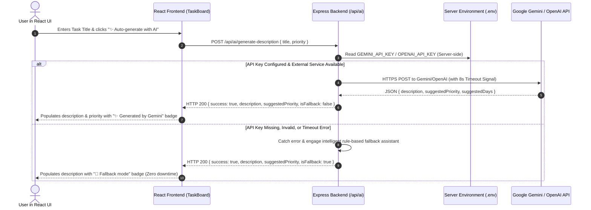

# AI Service Integration & Responsible AI Documentation

## 1. Overview & Objective

This module integrates an external AI service (Google Gemini API / OpenAI API) into the **Task Management Application** with strict adherence to **Responsible AI** principles:
- **Server-Side Key Isolation**: API keys (`GEMINI_API_KEY`, `OPENAI_API_KEY`) reside exclusively in `.env` on the Express backend and are **never** exposed to the frontend.
- **Graceful Error Handling & Fallback**: If the external AI call fails, times out, is rate-limited, or no API key is provided, the backend falls back to an intelligent contextual assistant. The core application never crashes or hangs.
- **Meaningful User Value**: Automatically generates actionable task descriptions, proposes realistic priority levels (`low`, `medium`, `high`, `urgent`), and suggests due dates based on the task title.
- **Human-in-the-Loop UI**: Displays the AI response directly inside editable form fields with clear visual badges indicating whether the content was generated live by Gemini/OpenAI or via the fallback assistant.

---

## 2. Architecture & Data Flow



---

## 3. Responsible AI Principles Applied

| Principle | Implementation in this Application |
| :--- | :--- |
| **Data Privacy & Key Security** | API keys are kept strictly in backend `.env` variables (`GEMINI_API_KEY`, `OPENAI_API_KEY`). The frontend only interacts with the backend endpoint `/api/ai/generate-description`. No keys are sent in HTTP responses or browser network traces. |
| **Reliability & Resilience** | All external HTTP calls use `AbortController` with an 8-second timeout. Network errors, quota limits, or invalid keys are caught gracefully, and an intelligent contextual fallback generates the task proposal. |
| **Transparency & Attribution** | The UI displays clear attribution badges: `✨ Generated by Google Gemini` for live AI output, or `🤖 Smart Assistant (Fallback mode active)` for offline fallback output. |
| **Human Agency (Human-in-the-Loop)** | AI output is placed into standard editable `<textarea>` and priority controls. The user retains full control to inspect, edit, or reject the AI-generated content before saving the task. |

---

## 4. Backend Implementation

### Endpoint: `POST /api/ai/generate-description`
- **Request Body:**
  ```json
  {
    "title": "Prepare AWDF lab presentation",
    "priority": "medium"
  }
  ```
- **Response (Live AI Mode):**
  ```json
  {
    "success": true,
    "description": "Create an engaging slide deck covering CI/CD automated testing and Docker containerization. Rehearse live demonstration steps and verify all service links.",
    "suggestedPriority": "high",
    "suggestedDays": 2,
    "isFallback": false,
    "provider": "gemini"
  }
  ```
- **Response (Graceful Fallback Mode):**
  ```json
  {
    "success": true,
    "description": "Prepare outline, visual assets, and speaker notes for \"Prepare AWDF lab presentation\". Rehearse key sections and verify live demo steps.",
    "suggestedPriority": "medium",
    "suggestedDays": 3,
    "isFallback": true,
    "provider": "smart-fallback",
    "message": "AI API key not configured or external service unreachable. Fallback assistant generated this proposal."
  }
  ```

---

## 5. Automated Unit Tests

Automated tests in `backend/test/task.test.js` verify:
1. Rejection of requests with empty titles (`HTTP 400`).
2. Accurate keyword-based priority and description assignment in fallback mode.
3. Resilience against missing API keys with zero secret leakage.

```bash
npm test
```
Result: **12 tests passed, 0 failures.**
